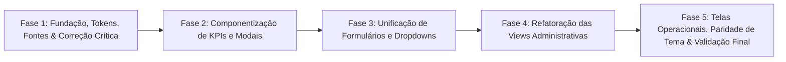

# Plano de Implementação da Arquitetura CSS e Padronização Visual — Servindoor 2026

**Data:** 10 de Outubro de 2026  
**Documento de Referência:** `RELATORIO_AUDITORIA_CSS_FRONTEND.md`  
**Objetivo:** Estabelecer uma arquitetura de estilos unificada, modular e governada, eliminando inconsistências visuais, integrando a tipografia **Quattrocento**, erradicando o uso abusivo de `!important` e garantindo que todas as telas pertençam organicamente ao mesmo sistema visual (Cyber Dark e Light Mode compatíveis).

---

## 1. Visão Geral da Transformação Arquitetural

### 1.1. Estado Atual vs. Estado Desejado

| Dimensão | Estado Atual (Legado) | Estado Desejado (Nova Arquitetura) |
| :--- | :--- | :--- |
| **Organização Global** | 1 arquivo monolítico (`main.css`) misturando tokens, resets e 315 linhas de CSS privado de tela. | Diretório modular `assets/css/` separado em tokens, tipografia, resets, utilitários e componentes canônicos. |
| **Componentização UI** | `KpiCard.vue` abandonado (0 usos); cada view recria seu HTML/CSS de métricas, filtros e modais. | Biblioteca interna de componentes atômicos (`KpiCard`, `Dropdown`, `Modal`, `SearchInput`) consumida por todas as views. |
| **Campos de Formulário** | Classes inexistentes (`.form-control-custom`), inputs brancos não estilizados no Modal de Extravio. | Padrão universal `.form-control`, alias compatíveis, tema dark nativo para inputs, textareas e selects. |
| **Tipografia** | Mistura desregulada de `Outfit` e `Plus Jakarta Sans` com `clamp()` arbitrários e monospace fragmentado. | Escala modular com tokens `--fs-*`, `Plus Jakarta Sans` para corpo, `Outfit` para números/display e **Quattrocento** para certificados/títulos solenes. |
| **Guerra do `!important`** | 412 ocorrências de `!important` disputando especificidade entre scoped e global. | Eliminação sistemática de `!important`, baseada em cascata limpa e especificidade natural de seletores. |
| **Cores e Temas** | 880 hexadecimais e 1.101 `rgba()` hardcoded; tema claro (`[data-theme="light"]`) quebrado na quase totalidade das views. | Cores baseadas 100% em design tokens semânticos (`var(--bg-card)`, `var(--text-main)`), com paridade total no tema claro. |

---

## 2. Incorporação da Nova Tipografia: Quattrocento

A fonte clássica com serifa **Quattrocento** (pesos 400 e 700) será introduzida na camada de tipografia como a família de prestígio e solenidade do evento.

### 2.1. Papel Semântico no Sistema
- **`Plus Jakarta Sans` (`--font-body`):** Interface densa, formulários, tabelas, textos corridos, modais e navegação.
- **`Outfit` (`--font-display`):** Identidade cyber/moderna, números de métricas (KPIs), contadores de cronômetro, badges e tags de status.
- **`Quattrocento` (`--font-serif`):** Tipografia nobre e solene para convites oficiais, títulos de vouchers (`MeuIngressoView`), certificados de premiação (`MeusPremiosView` e `EntregaPremiosView`), selos de autenticidade e banners institucionais.

### 2.2. Ingestão e Tokens
No arquivo `frontend/index.html`:
```html
<link rel="preconnect" href="https://fonts.googleapis.com">
<link rel="preconnect" href="https://fonts.gstatic.com" crossorigin>
<link href="https://fonts.googleapis.com/css2?family=Outfit:wght@400;500;600;700;800;900&family=Plus+Jakarta+Sans:wght@400;500;600;700;800&family=Quattrocento:wght@400;700&display=swap" rel="stylesheet">
```

No novo arquivo de tokens `frontend/src/assets/css/typography.css`:
```css
:root {
  --font-main: 'Plus Jakarta Sans', system-ui, -apple-system, sans-serif;
  --font-display: 'Outfit', sans-serif;
  --font-serif: 'Quattrocento', Georgia, serif;
}

/* Classes Utilitárias Oficiais */
.font-quattrocento,
.quattrocento-regular {
  font-family: var(--font-serif);
  font-weight: 400;
  font-style: normal;
}

.quattrocento-bold {
  font-family: var(--font-serif);
  font-weight: 700;
  font-style: normal;
}
```

---
## 3. Nova Estrutura de Arquitetura de Estilos

A estrutura física do frontend será reorganizada em módulos especialistas, com responsabilidades estritas e sem vazamentos de escopo:

```
frontend/src/
├── assets/
│   ├── css/
│   │   ├── tokens.css              # Design tokens (cores, superfícies, sombras, raios, transições)
│   │   ├── reset.css               # Reset universal, box-sizing, scrollbars e html/body
│   │   ├── typography.css          # Fontes (Outfit, Plus Jakarta Sans, Quattrocento), escalas e títulos
│   │   ├── utilities.css           # Grid, Flexbox, gaps, margens, paddings, alinhamentos
│   │   └── components/             # Estilos de componentes canônicos reutilizáveis
│   │       ├── buttons.css         # .btn, .btn-primary, .btn-secondary, .btn-danger, .btn-action-icon
│   │       ├── forms.css           # .form-control, .form-select, .form-label, foco, validações
│   │       ├── tables.css          # .custom-table, cabeçalhos, zebra, hover, .table-responsive
│   │       ├── cards.css           # .card-surface, .card-glass, .card-vip
│   │       ├── badges.css          # .badge-role, .badge-status, .badge-subtle-*
│   │       └── modals.css          # .modal-backdrop-custom, .modal-content-custom
│   └── main.css                    # Ponto único de agregação (@import dos módulos acima)
├── components/
│   ├── KpiCard.vue                 # Componente KPI canônico e parametrizado (display + interativo)
│   ├── Modal.vue                   # Shell de modal acessível com foco gerenciado
│   ├── ConfirmModal.vue            # Modal de confirmação reativo
│   ├── FaqModal.vue                # Modal de FAQ
│   ├── DropdownSelect.vue          # [Novo] Dropdown customizado rico com busca e Dark Mode perfeito
│   └── SearchBar.vue               # [Novo] Campo de busca padronizado com botão limpar
```

---

## 4. Solução Técnica dos Problemas Identificados

### 4.1. Resolução do BUG-01 (Inputs sem estilo no Modal de Extravio)
- **Causa Raiz:** Uso de classe inexistente `.form-control-custom`.
- **Ação:**
  1. Em `forms.css`, definir a regra canônica em `.form-control` e criar um alias permanente:
     ```css
     .form-control,
     .form-control-custom {
       width: 100%;
       background: var(--bg-input);
       border: 1px solid var(--border-glass);
       border-radius: var(--radius-md, 12px);
       padding: 12px 14px;
       color: var(--text-main);
       font-family: var(--font-main);
       font-size: 0.95rem;
       transition: border-color var(--transition-fast), box-shadow var(--transition-fast);
     }
     .form-control:focus,
     .form-control-custom:focus {
       outline: none;
       border-color: var(--primary-accent);
       box-shadow: 0 0 0 3px rgba(6, 182, 212, 0.25);
       background: var(--bg-surface);
     }
     ```
  2. Atualizar o template em `AdminParticipantesView.vue` (linhas 1178 e 1192) e em `AdminCancelamentosView.vue` (linha 691) para utilizar `.form-control`.

### 4.2. Resolução do BUG-02 (Divergência dimensional nos KPIs)
- **Causa Raiz:** Componente `KpiCard.vue` não utilizado; markup e CSS duplicados e divergentes entre telas.
- **Ação:**
  1. Refatorar `KpiCard.vue` para unificar:
     - Altura e padding padronizados (`padding: 18px 20px`, `border-radius: 16px`).
     - Ícone centralizado em caixa de `48px x 48px` com raio de `14px` e fonte de `1.5rem`.
     - Tipografia: Label em `0.75rem` uppercase, valor em `1.8rem font-outfit` peso 900.
     - Suporte a 3 linhas com slot/prop `subtitle` sem quebrar o alinhamento de cards vizinhos com 2 linhas (usando `min-height` estrutural).
     - Props `clickable` e `active` para suportar o estado de filtro selecionado de `AdminCancelamentosView` e `AdminParticipantesView`.
  2. Substituir as grades manuais em `AdminValidacoesView.vue`, `AdminCancelamentosView.vue`, `AdminParticipantesView.vue` e `AdminView.vue` por instâncias de `<KpiCard>`.
  3. Remover centenas de linhas de CSS redundante (`.kpi-card`, `.kpi-grid`, etc.) das views.

### 4.3. Resolução do BUG-03 (Dropdowns com aparências distintas e glifos corrompidos)
- **Causa Raiz:** Convivência de componente popover rico com `<select>` nativo que quebra o tema no Windows e exibe caracteres corrompidos (`??`).
- **Ação:**
  1. Corrigir os textos corrompidos no arquivo `AdminParticipantesView.vue` (trocar `?? Presente no Evento` por `🎫 Presente no Evento` e `🚪 Fora do Evento`).
  2. Implementar o componente reutilizável `DropdownSelect.vue` (baseado no padrão já validado de secretarias), permitindo opções com busca, checkboxes (modo múltiplo) ou seleção simples customizada.
  3. Unificar a altura de todos os controles da barra de filtros em `44px` com raio de `10px`.

### 4.4. Resolução do BUG-05 (Conflito de marca em `.btn-vip-mega`)
- **Causa Raiz:** `HomeView.vue` sobrescrevendo com gradiente vermelho choque via `!important`.
- **Ação:**
  1. Definir a variante semântica no CSS de botões (`.btn-vip-mega--alert` ou `.btn-vip-mega--home`) se a cor vermelha for uma exigência de produto para a Home, ou restaurar o gradiente oficial `--serv-gradient` para consistência de marca.
  2. Eliminar o `!important` do seletor em `HomeView.vue`.

### 4.5. Resolução do BUG-06 e BUG-07 (CSS vazado e utilitários duplicados)
- **Causa Raiz:** 315 linhas de CSS de modal de participante jogadas no `main.css` e utilitários recriados no scoped.
- **Ação:**
  1. Mover as 315 linhas de `info-participant-modal` para um componente modular `ParticipantModalContent.vue` ou para o scoped de `AdminParticipantesView.vue`.
  2. Mover todos os utilitários de layout (`.d-flex`, `.gap-*`, `.mb-*`, `.w-100`, `.flex-1`, etc.) para `utilities.css`, removendo as duplicatas de `AdminParticipantesView.vue` e `AdminSorteiosView.vue`.

---
## 5. Roteiro de Execução em Fases Controladas

O plano foi estruturado em **5 Fases Progressivas**, ordenadas por risco e impacto, permitindo entregas testáveis sem quebrar a operação em produção:



---

### Fase 1: Fundação, Tokens, Fontes & Correção Imediata de Emergência
- **Objetivo:** Estabelecer a infraestrutura de estilos, carregar a fonte **Quattrocento**, criar os utilitários compartilhados e resolver imediatamente o bug visual dos inputs desestilizados no Modal de Extravio sem mexer na estrutura interna dos componentes.
- **Passos Detalhados:**
  1. **Atualizar `index.html`:** Incluir o import da Google Fonts para `Quattrocento:wght@400;700`.
  2. **Criar a estrutura `frontend/src/assets/css/`:**
     - `tokens.css`: Definir variáveis de cores (Cyber Dark e Light Mode), raios (`--radius-sm: 8px`, `--radius-md: 12px`, `--radius-lg: 16px`), sombras e transições.
     - `typography.css`: Definir escala modular, classes `.font-outfit`, `.font-quattrocento`, `.quattrocento-regular`, `.quattrocento-bold` e títulos `.page-title`, `.page-subtitle`.
     - `utilities.css`: Centralizar `.d-flex`, `.d-grid`, `.gap-*`, `.mb-*`, `.w-100`, `.flex-1`, `.text-center`, etc.
     - `components/forms.css`: Definir `.form-control` e alias `.form-control-custom` para estilar textareas e inputs com dark mode perfeito.
  3. **Atualizar `main.css`:** Importar os novos módulos e manter compatibilidade total com o restante da aplicação.
  4. **Corrigir caracteres corrompidos:** Em `AdminParticipantesView.vue`, corrigir `?? Presente no Evento` e `?? Fora do Evento`.
- **Arquivos Afetados:**
  - `frontend/index.html`
  - `frontend/src/assets/css/tokens.css` (novo)
  - `frontend/src/assets/css/typography.css` (novo)
  - `frontend/src/assets/css/utilities.css` (novo)
  - `frontend/src/assets/css/components/forms.css` (novo)
  - `frontend/src/assets/main.css`
  - `frontend/src/views/AdminParticipantesView.vue` (correção pontual de caracteres)
- **Risco:** Mínimo.
- **Critérios de Aceite:**
  - O Modal de Extravio em `AdminParticipantesView.vue` e o Modal de Rejeição em `AdminCancelamentosView.vue` renderizam textareas e inputs perfeitamente estilizados com fundo escuro e glow ciano.
  - A fonte Quattrocento renderiza perfeitamente quando aplicada via classe `.font-quattrocento`.
  - Nenhuma tela existente quebra ou altera seu comportamento funcional.

---

### Fase 2: Componentização e Padronização de KPIs e Modais
- **Objetivo:** Acabar com a disparidade entre os cards de métricas em todas as telas e padronizar o comportamento dos modais.
- **Passos Detalhados:**
  1. **Refatorar `frontend/src/components/KpiCard.vue`:**
     - Implementar suporte para exibição de valor, label, subtítulo com alinhamento vertical balanceado.
     - Suportar prop `clickable` e prop `active` para comportamentos de filtro (como em Cancelamentos e Participantes).
     - Padronizar a caixa de ícone em 48px x 48px e borda de 16px com backdrop-filter blur.
  2. **Adotar `KpiCard.vue` nas telas administrativas:**
     - Substituir o markup manual em `AdminValidacoesView.vue`.
     - Substituir o markup manual em `AdminCancelamentosView.vue`.
     - Substituir o markup manual em `AdminParticipantesView.vue`.
     - Substituir o markup manual em `AdminView.vue`.
  3. **Limpar CSS duplicado de KPIs:**
     - Remover os blocos `.kpi-card`, `.kpi-grid`, `.kpi-icon-box` das views acima.
  4. **Padronizar botões de modais:**
     - Unificar o estilo dos botões de rodapé em `Modal.vue`, `ConfirmModal.vue` e `FaqModal.vue` usando as classes globais `.btn-primary`, `.btn-secondary`, `.btn-danger`.
- **Arquivos Afetados:**
  - `frontend/src/components/KpiCard.vue`
  - `frontend/src/components/Modal.vue`
  - `frontend/src/components/ConfirmModal.vue`
  - `frontend/src/views/AdminValidacoesView.vue`
  - `frontend/src/views/AdminCancelamentosView.vue`
  - `frontend/src/views/AdminParticipantesView.vue`
  - `frontend/src/views/AdminView.vue`
- **Risco:** Baixo.
- **Critérios de Aceite:**
  - Todos os painéis com 4 ou 3 KPIs exibem exatamente as mesmas dimensões, fontes, paddings e caixas de ícone.
  - A funcionalidade de clique para filtrar em Cancelamentos e Participantes continua funcionando de maneira transparente.

---

### Fase 3: Unificação de Formulários, Filtros e Dropdowns
- **Objetivo:** Eliminar o contraste entre selects nativos e menus customizados, garantindo consistência visual nas barras de ferramentas.
- **Passos Detalhados:**
  1. **Criar componente `DropdownSelect.vue`:**
     - Baseado na lógica de popover dark de `AdminParticipantesView.vue`.
     - Suporte a seleção única (`v-model`) e múltipla (checkboxes com contagem).
     - Campo de busca integrado opcional.
     - Ícones de status alinhados com tipografia oficial.
  2. **Atualizar a barra de filtros de `AdminParticipantesView.vue`:**
     - Substituir os selects nativos de \"Status no Evento\" e \"Lote\" pelo `DropdownSelect.vue`.
  3. **Atualizar filtros em `AdminValidacoesView.vue` e `AdminUsuariosView.vue`:**
     - Substituir `.form-select-custom` e classes fragmentadas pelo componente unificado.
  4. **Padronizar a barra de filtros (`.filter-card`):**
     - Altura fixa de 44px para todos os campos, bordas arredondadas de 10px e fundo translúcido consistente.
- **Arquivos Afetados:**
  - `frontend/src/components/DropdownSelect.vue` (novo)
  - `frontend/src/views/AdminParticipantesView.vue`
  - `frontend/src/views/AdminValidacoesView.vue`
  - `frontend/src/views/AdminUsuariosView.vue`
- **Risco:** Médio.
- **Critérios de Aceite:**
  - Todos os dropdowns e selects em uma mesma linha abrem com a mesma estética visual Dark, sem popups cinzas nativos do sistema operacional.
  - Seleção por teclado e fechamento ao clicar fora operam com fluidez.

---
### Fase 4: Refatoração das Views Administrativas e Limpeza de CSS Vazado
- **Objetivo:** Remover as 315 linhas vazadas de `main.css`, eliminar utilitários locais e reduzir o volume de `!important` nas telas administrativas.
- **Passos Detalhados:**
  1. **Extrair o Modal de Participantes de `main.css`:**
     - Mover as regras `.info-participant-modal`, `.participant-hero-card`, etc., para dentro do escopo de `AdminParticipantesView.vue` (ou componente filho).
     - Remover as regras com `!important` forçadas em dimensões de avatar.
  2. **Remover os utilitários de emergência em `AdminParticipantesView.vue` e `AdminSorteiosView.vue`:**
     - Deletar os blocos de `.d-flex`, `.gap-*`, `.mb-*` com `!important` que agora residem globalmente em `utilities.css`.
  3. **Padronizar tabelas e botões de ação:**
     - Adotar a classe padrão `.btn-action-icon` (36px x 36px) em todas as colunas de ação de tabelas em `AdminParticipantesView.vue`, `AdminUsuariosView.vue`, `AdminValidacoesView.vue` e `AdminView.vue`.
     - Padronizar os cabeçalhos de tabela com a classe `.custom-table` e variáveis `--table-head-bg`.
- **Arquivos Afetados:**
  - `frontend/src/assets/main.css`
  - `frontend/src/views/AdminParticipantesView.vue`
  - `frontend/src/views/AdminSorteiosView.vue`
  - `frontend/src/views/AdminUsuariosView.vue`
  - `frontend/src/views/AdminValidacoesView.vue`
- **Risco:** Médio.
- **Critérios de Aceite:**
  - `main.css` tem seu tamanho reduzido significativamente.
  - O Modal de Perfil de Participante continua funcionando e estilizando perfeitamente.
  - Eliminação de mais de 100 declarações `!important` desnecessárias.

---

### Fase 5: Telas Operacionais/Públicas, Aplicação de Quattrocento e Paridade de Tema
- **Objetivo:** Extender a coerência visual para as telas públicas (Home, Resgate, Meu Ingresso, Prêmios, Portaria e Telão), aplicar **Quattrocento** nos locais de prestígio e validar o Tema Claro.
- **Passos Detalhados:**
  1. **Aplicar Quattrocento nos elementos solenes:**
     - Em `MeuIngressoView.vue`: Aplicar `.font-quattrocento` no título do voucher oficial, nas menções solenes da portaria e no número de protocolo de segurança.
     - Em `MeusPremiosView.vue` e `EntregaPremiosView.vue`: Aplicar `.font-quattrocento` nos títulos de certificados de premiação e ganhadores de sorteio.
     - Em `HomeView.vue`: Aplicar `.font-quattrocento` nos títulos cerimoniais da festa e na chamada institucional do evento.
  2. **Resolver o conflito do `.btn-vip-mega`:**
     - Alinhar a identidade visual do botão na Home e no Resgate com `--serv-gradient` ou variante bem definida, eliminando a sobrescrita destrutiva de `HomeView.vue`.
  3. **Substituir cores hexadecimais por Design Tokens:**
     - Trocar `#0f172a`, `rgba(15, 23, 42, ...)` e textos fixos `#fff` pelas variáveis de tema `var(--bg-card)`, `var(--text-main)`.
  4. **Validar o Tema Claro (`[data-theme="light"]`):**
     - Garantir legibilidade em 100% das telas ao alternar para o tema claro através de `useTheme.js`.
- **Arquivos Afetados:**
  - `frontend/src/views/HomeView.vue`
  - `frontend/src/views/ResgateView.vue`
  - `frontend/src/views/MeuIngressoView.vue`
  - `frontend/src/views/MeusPremiosView.vue`
  - `frontend/src/views/EntregaPremiosView.vue`
  - `frontend/src/views/PortariaView.vue`
  - `frontend/src/views/TelaoView.vue`
- **Risco:** Baixo.
- **Critérios de Aceite:**
  - A tipografia Quattrocento eleva a percepção de elegância nos vouchers e prêmios.
  - O tema claro funciona harmonicamente em todo o ecossistema sem manchas pretas ou textos ilegíveis.
  - Menos de 30 ocorrências de `!important` remanescentes em todo o projeto.

---

## 6. Matriz de Redução de Inconsistências

| Métrica de Qualidade | Antes da Refatoração | Meta Pós-Refatoração | Redução Esperada |
| :--- | :---: | :---: | :---: |
| **Declarações `!important`** | 412 | < 25 (apenas utilitários extremos) | **-94%** |
| **Linhas de CSS Scoped Fragmentado** | 11.433 | ~ 5.500 | **-52%** |
| **Componentes KPI Órfãos** | 1 não utilizado | 1 canônico usado em 4+ telas | **100% de reuso** |
| **Cores Hex/RGBA Hardcoded nos Vue** | 1.981 | < 150 (exceções artísticas/canvas) | **-92%** |
| **Variações de Títulos de Página** | 5 escalas divergentes | 1 escala modular única | **100% de coerência** |
| **Aparência de Dropdowns** | Mistas (HTML nativo vs custom) | 100% padronizadas com tema dark | **100% de coerência** |

---

## 7. Critérios de Homologação e Garantia de Não-Regressão

Para cada fase concluída, os seguintes passos de homologação devem ser executados:

1. **Build e Linter:**
   - Execução de `npm run build` para garantir que não há erros de empacotamento do Vite ou quebras de sintaxe no CSS.
2. **Inspeção de Estilos Computados no DevTools:**
   - Conferência de `box-sizing: border-box`, `font-family`, `border-radius` e `background-color`.
3. **Teste de Fluxo Ponta a Ponta:**
   - Validação da jornada completa: Resgate -> Emissão de Voucher (`MeuIngresso`) -> Homologação (`AdminValidacoes`) -> Cancelamento Administrativo por Extravio (`AdminParticipantes`) -> Conferência Facial (`AdminCancelamentos`) -> Portaria (`PortariaView`).
4. **Validação Multi-Viewport:**
   - Teste em resoluções mobile (375px), tablet (768px) e desktop (1440px).

---
*Plano de Implementação aprovado para execução controlada e modular.*