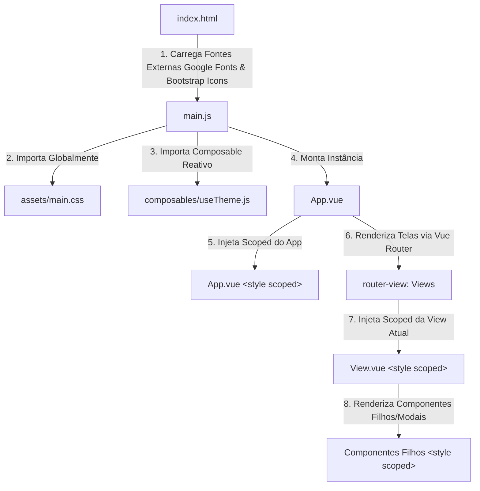

# Auditoria Minuciosa da Arquitetura CSS e da Consistência Visual — Servindoor 2026

**Data da Auditoria:** 10 de Outubro de 2026  
**Projeto:** Servindoor 2026 (Frontend Vue 3 + Vite)  
**Ambiente de Execução:** Ubuntu (WSL2) / Node.js / Vite 6.2.0 / Vue 3.5.13  
**Status da Auditoria:** Concluída (Fase de Diagnóstico e Arquitetura — Código funcional estritamente preservado)

---

## A. Resumo Executivo

### 1. Diagnóstico Geral do Sistema
O frontend do **Servindoor 2026** apresenta uma arquitetura visual híbrida e fragmentada, caracterizada pela ausência de governança de estilos e pela coexistência desordenada de três camadas conceituais que concorrem entre si:
1. **Camada Global Teórica (`frontend/src/assets/main.css` - 1.386 linhas):** Contém tokens de cores e temas (:root), mas carece de um sistema utilitário abrangente (faltam utilitários de flexbox, espaçamento sistemático e dimensões). Paradoxalmente, inclui blocos massivos de regras altamente acopladas a componentes específicos (como 315 linhas dedicadas exclusivamente ao modal de participantes).
2. **Camada Scoped Descentralizada (26 componentes e views `.vue` - 11.433 linhas de CSS):** Concentra **90,3%** de todo o CSS do projeto. Cada tela foi desenvolvida de forma insular, recriando do zero cards de métricas (KPIs), tabelas, modais, formulários, botões de ação e filtros.
3. **Corrida Armamentista da Especificidade (`!important` e Overrides):** Foram mapeadas **412 ocorrências de `!important`** no código (89 no CSS global e 323 distribuídas nos componentes, lideradas por `AdminParticipantesView.vue` com 115 e `HomeView.vue` com 107). Desenvolvedores recorreram a `!important` para contornar colisões de especificidade geradas pelo atributo `[data-v-xxxx]` do Vue ou para sobrepor estilos herdados.

### 2. Principais Causas Raiz da Inconsistência Visual
- **Inexistência de Componentes Reutilizáveis em Uso:** Embora o componente `components/KpiCard.vue` exista no repositório, ele **nunca foi importado em nenhuma tela** (0 referências no projeto). Cada visão (`AdminValidacoesView.vue`, `AdminCancelamentosView.vue`, `AdminParticipantesView.vue`) construiu seu próprio markup HTML e regras CSS locais para exibir KPIs.
- **Dissonância entre Nativos e Customizados:** Em uma mesma barra de ferramentas, controles com o mesmo propósito foram implementados de formas antagônicas — um dropdown customizado rico com popover Vue, busca e checkboxes (`showDropdownSec`) ao lado de elementos `<select>` nativos do navegador (`form-select filter-select`) com rendering inconsistente e dependente do sistema operacional.
- **Falha de Escopo e Ilusão de Classe Global:** O erro visual crítico nos inputs do modal de cancelamento administrativo de ingressos decorre do uso de uma classe inexistente no escopo global (`form-control-custom`). Essa classe foi criada localmente dentro de blocos `<style scoped>` de outras telas (`AdminValidacoesView.vue`, `MeuIngressoView.vue`), levando o autor do modal em `AdminParticipantesView.vue` a acreditar que se tratava de um padrão global, quando na verdade os campos estavam desprovidos de qualquer regra CSS ativa, caindo para a folha padrão do navegador (User-Agent Stylesheet).
- **Abandono do Design System em Prol de Cores Hardcoded:** Foram identificadas **880 cores hexadecimais brutas** e **1.101 declarações `rgba(...)`** hardcoded nos arquivos Vue, contra apenas 192 referências às variáveis `var(--...)`. Como consequência, o suporte ao tema claro (`data-theme="light"`) está completamente inoperante nas views administrativas e operacionais.

---
## B. Mapa de Estilos

### 1. Ponto de Entrada e Ordem de Injeção
A cascata de estilos da aplicação segue o seguinte fluxo de resolução em tempo de execução:



### 2. Ordem Efetiva da Cascata no DOM
1. **Folha de Estilos do Navegador (User-Agent Stylesheet):** Estilos nativos de `<input>`, `<textarea>`, `<select>`, `<body>`.
2. **CDN / Fontes Externas (`index.html`):**
   - Google Fonts: `Outfit` (pesos 400 a 900) e `Plus Jakarta Sans` (pesos 400 a 800).
   - Bootstrap Icons CDN: `bootstrap-icons.min.css` (fornece apenas glifos de ícones, **não inclui Bootstrap CSS**).
3. **CSS Global (`frontend/src/assets/main.css` - 1.386 linhas):**
   - Configuração de tokens em `:root` e `[data-theme="light"]`.
   - Normalização básica (`* { box-sizing: border-box; }`, `body { ... }`).
   - Classes globais de botões (`.btn-primary`, `.btn-vip-mega`, `.btn-action-icon`).
   - Classes estruturais de tabela (`.custom-table`).
   - Classes estruturais de formulário (`.form-group`, `.form-control`, `.form-select`).
   - Classes de modais (`.modal-backdrop-custom`, `.modal-content-custom`).
   - Código acoplado deslocado (linhas 759-1074: Modal de Participante).
4. **CSS Scoped dos Componentes (`<style scoped>` nos arquivos `.vue`):**
   - Compilados pelo `@vitejs/plugin-vue` com injeção de seletores de atributo `[data-v-xxxx]`.
   - Adicionados dinamicamente na tag `<head>` **após** o `main.css`, garantindo primazia por ordem de declaração e especificidade contra seletores globais simples.
5. **Estilos Inline (`:style="..."` e `style="..."`):**
   - 104 ocorrências mapeadas no projeto, com a maior especificidade de cascata `(1, 0, 0, 0)`.

### 3. Matriz de Inventário dos Arquivos de Estilo

| Arquivo | Escopo | Linhas Totais | Linhas CSS | `!important` | :deep() | Inline Styles | Responsabilidade Atual Declarada |
| :--- | :---: | :---: | :---: | :---: | :---: | :---: | :--- |
| `src/assets/main.css` | Global | 1.386 | 1.386 | 89 | 0 | 0 | Design tokens, resets, botões padrão, tabelas, modais globais e CSS vazado de participante. |
| `src/App.vue` | Scoped | 99 | 68 | 15 | 0 | 2 | Layout root (`.app-root`, `.main-content`), rodapé (`.app-footer`, `.footer-home`). |
| `src/components/Modal.vue` | Scoped | 260 | 36 | 0 | 0 | 4 | Shell genérico de modal (`<Teleport to="body">`). Depende de classes de `main.css`. |
| `src/components/ConfirmModal.vue` | Scoped | 320 | 189 | 0 | 0 | 0 | Modal autônomo de confirmação com animação própria e botões duplicados. |
| `src/components/FaqModal.vue` | Scoped | 1.079 | 628 | 2 | 0 | 4 | Modal autônomo de dúvidas, recriando overlay, cabeçalho e formulário administrativo. |
| `src/components/KpiCard.vue` | Scoped | 153 | 107 | 0 | 0 | 0 | **Componente KPI órfão (nunca importado em nenhuma tela).** |
| `src/components/Navbar.vue` | Scoped | 912 | 423 | 8 | 0 | 5 | Barra de navegação principal, badges, menu mobile e dropdowns de perfil. |
| `src/components/ToastContainer.vue` | Scoped | 240 | 169 | 0 | 0 | 1 | Sistema de notificações toast empilháveis. |
| `src/components/WebcamCapture.vue` | Scoped | 356 | 209 | 7 | 0 | 2 | Captura de biometria facial, guias de alinhamento e molduras de câmera. |
| `src/views/AdminParticipantesView.vue` | Scoped | 3.349 | 1.525 | 115 | 0 | 18 | Gestão de servidores, 3 KPIs locais, multiselect de secretarias, tabela e 3 modais. |
| `src/views/AdminSorteiosView.vue` | Scoped | 2.630 | 1.148 | 6 | 0 | 6 | Painel de controle de sorteios, telão ao vivo, tabelas e cards operacionais. |
| `src/views/HomeView.vue` | Scoped | 1.935 | 887 | 107 | 0 | 12 | Landing page com lotes, cronômetros, botões VIP e lista de prêmios. |
| `src/views/TelaoView.vue` | Scoped | 1.369 | 828 | 0 | 0 | 2 | Projeção em tela cheia com animação de roleta, tipografia de grande escala e efeitos de partículas. |
| `src/views/AdminCancelamentosView.vue` | Scoped | 1.554 | 812 | 4 | 0 | 8 | Central de cancelamentos, 4 KPIs locais com filtro ativo, filtros e conferência facial. |
| `src/views/AdminValidacoesView.vue` | Scoped | 1.658 | 806 | 2 | 0 | 7 | Homologação de cadastros, 4 KPIs estáticos locais, barra de filtros e tabela de dados. |
| `src/views/MeuIngressoView.vue` | Scoped | 1.381 | 662 | 24 | 0 | 6 | Exibição de voucher QR Code, download de arte e solicitação de cancelamento. |
| `src/views/AdminView.vue` | Scoped | 1.821 | 642 | 0 | 0 | 4 | Dashboard geral com gráficos, tabelas resumidas de auditoria e ações de lote. |
| `src/views/PortariaView.vue` | Scoped | 1.030 | 593 | 29 | 0 | 9 | Scanner de portaria QR Code, feedback sonoro, checagem de fluxo de entrada/saída. |
| `src/views/AdminUsuariosView.vue` | Scoped | 1.438 | 498 | 1 | 0 | 3 | Cadastro de equipe e controle de papéis (RBAC). |
| `src/views/EntregaPremiosView.vue` | Scoped | 1.076 | 392 | 1 | 0 | 2 | Terminal do operador de entrega de brindes aos ganhadores. |
| `src/views/ResgateView.vue` | Scoped | 1.630 | 353 | 4 | 0 | 2 | Formulário público de resgate de convites por CPF e upload de foto funcional. |
| `src/views/AcessoPinView.vue` | Scoped | 604 | 325 | 2 | 0 | 1 | Tela de gatekeeper de proteção de rota por PIN numérico. |
| `src/views/SucessoView.vue` | Scoped | 614 | 247 | 6 | 0 | 1 | Confirmação de resgate com QR Code e animação de confetes. |
| `src/views/LoteIngressosView.vue` | Scoped | 469 | 244 | 0 | 0 | 2 | Listagem e auditoria dos ingressos emitidos por lote. |
| `src/views/MeusPremiosView.vue` | Scoped | 422 | 223 | 0 | 0 | 1 | Consulta pública de brindes sorteados vinculados ao CPF. |
| `src/views/LoginView.vue` | Scoped | 528 | 167 | 0 | 0 | 1 | Autenticação administrativa com controle de conflito de sessão. |
| `src/views/ErroView.vue` | Scoped | 88 | 52 | 0 | 0 | 1 | Exibição de erros de rota e ingressos inválidos. |

---
## C. Inventário de Problemas

### [BUG-01] Falha de Renderização nos Campos de Input do Modal de Cancelamento por Extravio
- **Gravidade:** Crítica
- **Componente / Tela:** Modal `Cancelar Ingresso (Extravio Administrativo)` em `src/views/AdminParticipantesView.vue`.
- **Arquivos e Linhas:**
  - `src/views/AdminParticipantesView.vue`, linhas 1178 e 1192 (uso de `class="form-control-custom w-100"`).
  - `src/views/AdminValidacoesView.vue`, linhas 1033-1049 (declaração scoped isolada).
  - `src/views/MeuIngressoView.vue`, linhas 798-814 (declaração scoped isolada).
  - `src/components/FaqModal.vue`, linhas 711-726 (declaração scoped isolada).
  - `src/assets/main.css`, linha 544 (classe global é `.form-control`, não `.form-control-custom`).
- **Regras Conflitantes:**
  - Regra esperada: `.form-control` (definida globalmente em `main.css:544`) com fundo escuro `var(--bg-input)`, borda de vidro `var(--border-glass)` e texto claro `var(--text-main)`.
  - Regra aplicada: Nenhuma classe customizada encontrada. Aplicação da folha de estilos do navegador (`user-agent stylesheet` do Chromium/Gecko/Safari):
    ```css
    textarea {
      background-color: field; /* Branco / cinza do SO */
      color: fieldtext; /* Preto do SO */
      border: 1px solid -internal-light-dark(#767676, #858585);
      font-family: monospace;
    }
    input[type="password"] {
      background-color: field;
      color: fieldtext;
    }
    ```
- **Causa Técnica Demonstrada:** A classe `.form-control-custom` nunca existiu no CSS global (`main.css`) nem no `<style scoped>` de `AdminParticipantesView.vue`. Ela foi inventada dentro do `<style scoped>` de outras views. Por causa do isolamento de escopo do Vue (`[data-v-xxxx]`), essas regras jamais vazam para outros componentes. O desenvolvedor usou a classe acreditando que ela fosse um padrão do sistema.
- **Consequência Visual:** Campos com fundo branco rígido, borda cinza padrão de sistema operacional dos anos 90, fonte monoespaçada bruta na área de texto e texto preto que quebra violentamente a estética Cyber Dark do Servindoor.
- **Outras Telas Afetadas:** `src/views/AdminCancelamentosView.vue` (linha 691) possui exatamente o mesmo bug no campo de motivo da rejeição de cancelamento (`<textarea class="form-control-custom">`), que também renderiza desprovido de estilo.

---

### [BUG-02] Dissonância Dimensional e Estrutural nos Cards de Métricas (KPIs)
- **Gravidade:** Alta
- **Componente / Tela:** Cards KPI de `src/views/AdminValidacoesView.vue` vs. `src/views/AdminCancelamentosView.vue` vs. `src/views/AdminParticipantesView.vue`.
- **Arquivos e Linhas:**
  - `src/components/KpiCard.vue`, linhas 1-153 (componente compartilhado oficial, 0 utilizações).
  - `src/views/AdminValidacoesView.vue`, linhas 359-406 (markup) e 910-993 (CSS scoped).
  - `src/views/AdminCancelamentosView.vue`, linhas 238-297 (markup) e 815-918 (CSS scoped).
  - `src/views/AdminParticipantesView.vue`, linhas 582-640 (markup) e 1928-2015 (CSS scoped).
- **Regras Conflitantes:**
  - `AdminValidacoesView.vue`:
    ```css
    .kpi-grid { grid-template-columns: repeat(auto-fit, minmax(240px, 1fr)); }
    .kpi-card { padding: 20px; border-radius: 18px; background: rgba(15, 23, 42, 0.75); backdrop-filter: blur(12px); box-shadow: 0 8px 24px rgba(0, 0, 0, 0.3); }
    .kpi-icon-box { width: 52px; height: 52px; font-size: 1.6rem; }
    .kpi-label { font-size: 0.74rem; }
    .kpi-desc { font-size: 0.74rem; color: #cbd5e1; } /* 3 linhas de texto */
    ```
  - `AdminCancelamentosView.vue`:
    ```css
    .kpi-grid { grid-template-columns: repeat(auto-fit, minmax(220px, 1fr)); }
    .kpi-card { padding: 18px 20px; border-radius: 16px; background: rgba(15, 23, 42, 0.7); }
    .kpi-icon-box { width: 50px; height: 50px; font-size: 1.45rem; }
    .kpi-label { font-size: 0.78rem; }
    /* Sem .kpi-desc! Apenas 2 linhas de texto */
    ```
  - `AdminParticipantesView.vue`:
    ```css
    .kpi-card { padding: 18px 20px; border-radius: 18px; background: rgba(15, 23, 42, 0.65); backdrop-filter: blur(16px); }
    .kpi-icon-box { width: 48px; height: 48px; font-size: 1.5rem; }
    ```
- **Causa Técnica Demonstrada:** Fragmentação da implementação. Ao invés de parametrizar o componente oficial `KpiCard.vue`, cada desenvolvedor programou seu próprio HTML e CSS scoped. `AdminValidacoesView` incluiu uma terceira linha (`.kpi-desc`) e caixas de ícone de 52px com padding de 20px, tornando os cards substancialmente mais altos e robustos que os de `AdminCancelamentosView` (que possuem apenas 2 linhas de texto, ícones de 50px e padding de 18px).
- **Consequência Visual:** Dois painéis administrativos com a mesma finalidade possuem alturas discrepantes, raios de borda incompatíveis (18px vs 16px), tamanhos de ícone assimétricos (52px vs 50px vs 48px) e tipografia desigual.

---

### [BUG-03] Quebra de Paradigma Visual em Controles de Seleção (Dropdown Customizado vs. Select Nativo)
- **Gravidade:** Alta
- **Componente / Tela:** Barra de Filtros em `src/views/AdminParticipantesView.vue` (linhas 660-750).
- **Arquivos e Linhas:**
  - `src/views/AdminParticipantesView.vue`, linhas 660-727 (multiselect customizado).
  - `src/views/AdminParticipantesView.vue`, linhas 731-750 (selects nativos com `.filter-select`).
  - `src/views/AdminParticipantesView.vue`, linhas 2081-2100 (estilos forçados com `!important`).
- **Regras Conflitantes:**
  - O controle de "Secretarias" é uma micro-aplicação Vue com popover flutuante (`.multiselect-dropdown-menu`), busca em tempo real, links de ação rápida e checkboxes estendidos.
  - O controle de "Status no Evento" e "Lotes" imediatamente ao lado utiliza a tag nativa `<select class="form-select filter-select">`.
  - O desenvolvedor tentou mascarar o select nativo com CSS:
    ```css
    .filter-select {
      background: rgba(0, 0, 0, 0.45) !important;
      border: 1px solid rgba(255, 255, 255, 0.1) !important;
      color: #ffffff !important;
      padding: 10px 14px !important;
      border-radius: 10px !important;
      height: 44px;
    }
    .filter-select option {
      background: #0f172a;
      color: #ffffff;
    }
    ```
- **Causa Técnica Demonstrada:** Limitação fundamental da renderização de controles de formulário nativos nos motores de renderização web. O elemento `<option>` em sistemas desktop é desenhado em uma janela overlay controlada pelo sistema operacional. O CSS customizado não se propaga para o popup de opções no Windows (onde ele ignora fontes, sombras e alinhamentos de ícones). Além disso, os textos das opções contêm caracteres corrompidos no código-fonte (`?? Presente no Evento` e `?? Fora do Evento` nas linhas 745-746).
- **Consequência Visual:** O usuário clica no primeiro controle e recebe um elegante menu flutuante translúcido com busca e animação. Ao clicar no controle vizinho de mesma hierarquia, abre-se a lista rígida do sistema operacional com fundo cinza-claro, emojis desalinhados e interrogação dupla (`??`).

---
### [BUG-04] Fragmentação Tipográfica e Quebra de Escala Modular
- **Gravidade:** Média
- **Componente / Tela:** Títulos de página (`.page-title`), subtítulos e badges em todo o sistema.
- **Arquivos e Linhas:**
  - `src/views/AdminValidacoesView.vue:866`
  - `src/views/AdminCancelamentosView.vue:774`
  - `src/views/MeusPremiosView.vue:209`
  - `src/views/EntregaPremiosView.vue:688`
  - `src/views/AdminSorteiosView.vue:1496`
  - `src/views/AdminParticipantesView.vue:3007`
- **Regras Conflitantes:**
  - `AdminValidacoesView`: `font-size: clamp(1.6rem, 4vw, 2.1rem); font-weight: 800; margin: 0;`
  - `AdminCancelamentosView`: `font-size: clamp(1.6rem, 3.5vw, 2.2rem); font-weight: 900; margin: 0 0 6px;`
  - `MeusPremiosView`: `font-size: clamp(1.8rem, 4vw, 2.4rem); font-weight: 900; margin-bottom: 6px;`
  - `EntregaPremiosView`: `font-size: 2.2rem; font-weight: 800; margin-bottom: 4px;`
  - `AdminSorteiosView`: `font-size: clamp(1.6rem, 4vw, 2.1rem); font-weight: 800; margin-bottom: 4px;`
- **Causa Técnica Demonstrada:** Ausência de uma escala tipográfica padronizada em variáveis CSS no `main.css`. Cada autor inventou seus próprios parâmetros de função `clamp()`, pesos de fonte (800 vs 900) e margens inferiores (0px, 4px, 6px), sem uma hierarquia tipográfica única.
- **Consequência Visual:** Ao navegar entre os painéis administrativos, o cabeçalho sofre deslocamentos verticais de layout (layout shift) e alterações perceptíveis no peso e tamanho dos títulos.

---

### [BUG-05] Conflito de Marca e Sobrescrita Violenta em `.btn-vip-mega`
- **Gravidade:** Média
- **Componente / Tela:** Botão de chamada principal em `src/views/HomeView.vue` vs. `src/views/ResgateView.vue`.
- **Arquivos e Linhas:**
  - `src/assets/main.css`, linhas 218-243 (padrão global de gradiente da marca).
  - `src/views/HomeView.vue`, linhas 1162-1170 (sobrescrita scoped com `!important`).
- **Regras Conflitantes:**
  - `main.css`:
    ```css
    .btn-vip-mega {
      background: var(--serv-gradient); /* Gradiente Oficial Magenta -> Âmbar -> Ciano */
      box-shadow: 0 10px 30px rgba(217, 70, 239, 0.45);
      font-size: clamp(1.1rem, 3.5vw, 1.35rem);
    }
    ```
  - `HomeView.vue`:
    ```css
    .btn-vip-mega {
      background: linear-gradient(135deg, #cc092f 0%, #ff1744 50%, #990000 100%) !important; /* Vermelho choque */
      box-shadow: 0 12px 35px rgba(255, 23, 68, 0.6) !important;
      border-color: rgba(255, 255, 255, 0.35) !important;
    }
    ```
- **Causa Técnica Demonstrada:** A `HomeView` introduziu regras scoped acompanhadas de `!important` para desconfigurar intencionalmente a identidade cromática global definida no `main.css`. Como a `ResgateView` usa a classe diretamente sem sobrescrita, ela exibe o botão com o gradiente oficial magenta/ciano/âmbar, enquanto a Home exibe o mesmo botão em tons de vermelho puro.
- **Consequência Visual:** Quebra de coerência da identidade visual de marca entre telas da mesma jornada de usuário.

---

### [BUG-06] Invasão do CSS Global com Regras Particulares de Componentes
- **Gravidade:** Média
- **Componente / Tela:** `src/assets/main.css`, linhas 759-1074.
- **Arquivos e Linhas:**
  - `src/assets/main.css`, linhas 759-1074 (315 linhas: `.info-participant-modal`, `.participant-hero-card`, etc.).
  - `src/views/AdminParticipantesView.vue`, linhas 990-1140 (markup que consome essas classes).
- **Regras Conflitantes:** Classes extremamente específicas para a tela de participantes (como `.participant-avatar-container`, `.participant-hero-name`, `.ticket-token-display`) foram inseridas diretamente na folha de estilos global.
- **Causa Técnica Demonstrada:** Como o modal é renderizado via `<Teleport to="body">` e o desenvolvedor teve dificuldades com seletores locais scoped atingindo elementos teleportados, transferiu centenas de linhas de CSS específico do componente para o arquivo `main.css`, poluindo o escopo global com 9 regras acompanhadas de `!important` (ex: `width: 90px !important`).
- **Consequência Visual:** Acoplamento severo. O arquivo `main.css` deixou de ser uma folha de fundação e design system para se tornar um repositório de remendos para contornar o comportamento do Vue.

---

### [BUG-07] Reinvenção de Classes Utilitárias dentro do Scoped CSS
- **Gravidade:** Média
- **Componente / Tela:** `src/views/AdminParticipantesView.vue`, linhas 2746-2769.
- **Arquivos e Linhas:**
  - `src/views/AdminParticipantesView.vue`, linhas 2746-2769.
  - `src/views/AdminSorteiosView.vue`, linhas 1540-1560.
- **Regras Conflitantes:**
  ```css
  .d-flex { display: flex !important; }
  .d-inline-flex { display: inline-flex !important; }
  .d-block { display: block !important; }
  .flex-column { flex-direction: column !important; }
  .align-items-center { align-items: center !important; }
  .justify-content-between { justify-content: space-between !important; }
  .gap-1 { gap: 4px !important; }
  .gap-2 { gap: 8px !important; }
  .gap-3 { gap: 16px !important; }
  .mb-0 { margin-bottom: 0 !important; }
  .mb-1 { margin-bottom: 4px !important; }
  .mb-2 { margin-bottom: 8px !important; }
  .mb-3 { margin-bottom: 16px !important; }
  .w-100 { width: 100% !important; }
  ```
- **Causa Técnica Demonstrada:** Os desenvolvedores escreveram o HTML dos componentes utilizando classes utilitárias clássicas. Porém, como nenhuma biblioteca de utilitários faz parte do projeto e o `main.css` não fornece essas classes, os layouts quebraram. Ao invés de centralizar as classes utilitárias no `main.css`, cada view passou a redeclarar seu próprio conjunto de utilitários com `!important` dentro do seu `<style scoped>`.
- **Consequência Visual:** Se uma view usa `class="d-flex gap-2"` no HTML mas não possui esse bloco de emergência no seu CSS scoped, o layout simplesmente não alinha e quebra silenciosamente.

---
## D. Comparativo dos Componentes

### 1. Matriz Comparativa: Cards de Métricas (KPIs)

| Atributo | `components/KpiCard.vue` (Órfão) | `AdminValidacoesView.vue` | `AdminCancelamentosView.vue` | `AdminParticipantesView.vue` |
| :--- | :--- | :--- | :--- | :--- |
| **Status de Uso** | 0 imports (abandonado) | Implementação local direta | Implementação local direta | Implementação local direta |
| **Grid / Layout** | N/A (componente do card) | `repeat(auto-fit, minmax(240px, 1fr))` | `repeat(auto-fit, minmax(220px, 1fr))` | Grade de 3 colunas |
| **Gap entre Cards** | N/A | `16px` | `16px` | `16px` |
| **Padding Interno** | `18px 20px` | `20px` | `18px 20px` | `18px 20px` |
| **Border Radius** | `14px` | `18px` | `16px` | `18px` |
| **Backdrop Filter** | Inexistente | `blur(12px)` | Inexistente | `blur(16px)` |
| **Sombra Padrão** | `0 4px 20px rgba(0,0,0,0.25)` | `0 8px 24px rgba(0,0,0,0.3)` | Inexistente | `0 8px 24px rgba(0,0,0,0.3)` |
| **Tamanho da Caixa do Ícone** | Não utiliza caixa fixa (slot) | `52px x 52px` | `50px x 50px` | `48px x 48px` |
| **Tamanho do Ícone** | N/A | `1.6rem` | `1.45rem` | `1.5rem` |
| **Tipografia do Valor** | `2rem`, peso 800 | `1.8rem`, peso 900 | `1.8rem`, peso 900 | `1.8rem`, peso 900 |
| **Linhas de Conteúdo** | Título + Valor + Subtítulo opcional | 3 linhas (Label + Valor + Subtítulo `.kpi-desc`) | 2 linhas (Label + Valor apenas) | 3 linhas (Label + Valor + Sublabel) |
| **Interatividade** | Hover com elevação | Estático (apenas display) | Clicável com filtro ativo (`.kpi-active`) | Clicável com filtro ativo (`.kpi-active`) |

---

### 2. Matriz Comparativa: Dropdowns e Elementos de Seleção

| Aspecto | Dropdown Customizado (`AdminParticipantes`) | Selects de Filtro (`AdminParticipantes`) | Selects Customizados (`AdminValidacoes`) | Select Global (`main.css`) |
| :--- | :--- | :--- | :--- | :--- |
| **Elemento HTML** | `<div>` + `<button>` + Popover Vue | `<select>` nativo | `<select>` nativo | `<select>` nativo |
| **Classe CSS** | `.multiselect-dropdown-menu` | `.form-select .filter-select` | `.form-select-custom` | `.form-select` |
| **Altura Declarada** | Auto (baseada no conteúdo) | `44px !important` | Auto (`padding: 11px 14px`) | Auto (`padding: 12px 14px`) |
| **Border Radius** | `14px` | `10px !important` | `12px` | `12px` |
| **Background do Menu** | `rgba(15, 23, 42, 0.98)` + blur | Controlado pelo SO / `#0f172a` parcial | Controlado pelo SO / `#0b0f19` | Controlado pelo SO |
| **Campo de Busca** | Sim integrado (`Filtrar secretarias...`) | Não | Não | Não |
| **Ações Rápidas** | "Selecionar Todas" / "Limpar" | Não | Não | Não |
| **Acessibilidade Teclado** | Parcial (suporte a clique e fechamento) | Nativa do navegador | Nativa do navegador | Nativa do navegador |
| **Glifos / Ícones** | Ícones Bootstrap perfeitos | Caracteres corrompidos (`?? Presente`) | Emojis no HTML (`✨`, `🟡`, `🟢`) | Sem suporte a ícones |

---

### 3. Matriz Comparativa: Campos de Formulário (Inputs & Textareas)

| Aspecto | Modal Extravio (`AdminParticipantes`) | Formulário Validação (`AdminValidacoes`) | Modal FAQ (`FaqModal`) | Padrão Global (`main.css`) |
| :--- | :--- | :--- | :--- | :--- |
| **Classe Utilizada** | `.form-control-custom` | `.form-control-custom` | `.form-control-custom` | `.form-control` |
| **Onde está declarada** | **Em lugar nenhum!** | No `<style scoped>` da View | No `<style scoped>` do Modal | No `main.css` global |
| **Fundo Renderizado** | Branco puro `#ffffff` (Nativo) | `#080d1a` | `#080d1a` | `var(--bg-input)` (`#080d1a`) |
| **Cor do Texto** | Preto `#000000` (Nativo) | `#f8fafc` | `#f8fafc` | `var(--text-main)` (`#f8fafc`) |
| **Borda Renderizada** | 1px/2px cinza chanfrada (Nativa) | `1px solid rgba(255,255,255,0.12)` | `1px solid rgba(255,255,255,0.12)` | `1px solid var(--border-glass)` |
| **Border Radius** | `0px` ou `2px` (Nativo) | `12px` | `10px` | `12px` |
| **Foco (`:focus`)** | Anel azul nativo do SO | Glow ciano `0 0 0 3px rgba(6,182,212,0.2)` | Glow ciano `0 0 0 3px rgba(6,182,212,0.2)` | Glow ciano `0 0 0 3px rgba(6,182,212,0.25)` |
| **Tipografia Textarea** | `monospace` (Nativa) | `inherit` (`Plus Jakarta Sans`) | `inherit` (`Plus Jakarta Sans`) | `inherit` (`Plus Jakarta Sans`) |

---

### 4. Matriz Comparativa: Modais do Sistema

| Aspecto | `components/Modal.vue` | `components/ConfirmModal.vue` | `components/FaqModal.vue` |
| :--- | :--- | :--- | :--- |
| **Mecanismo de Renderização** | `<Teleport to="body">` | `<Teleport to="body">` | `<Teleport to="body">` |
| **Origem do Estilo** | `main.css` (`.modal-backdrop-custom`) | Scoped local isolado (`.confirm-modal-overlay`) | Scoped local isolado (`.faq-modal-overlay`) |
| **Backdrop Blur** | `blur(8px)` | `blur(12px)` | `blur(8px)` |
| **Animação de Abertura** | Padrão CSS no `main.css` | Keyframes `confirm-pop` com cubic-bezier | Transição Vue `<Transition name="fade">` |
| **Border Radius do Card** | `20px` (definido em `main.css:604`) | `16px` (definido no scoped) | `20px` (definido no scoped) |
| **Z-Index** | Dinâmico (10.000 + 20*n) | Fixo em `999998` | Fixo em `1050` |
| **Botões de Ação** | Inseridos via slot pelo consumidor | Próprios (`.btn-confirm-*`, radius 8px) | Próprios (`.btn-save-faq`, `.btn-cancel-faq`) |

---
## E. Análise do CSS Global versus Estilos Locais

### 1. A Mecânica da Sobrescrita: Por que o Scoped Vence o Global?
Em aplicações Vue 3 gerenciadas pelo Vite, as regras contidas em blocos `<style scoped>` sobrepõem as regras globais de `assets/main.css` por dois fatores determinantes na cascata:

1. **Aumento da Especificidade do Seletor (Atributo `[data-v-xxxx]`):**
   - Um seletor global como `.kpi-card` possui especificidade `(0, 1, 0)`.
   - Quando compilado pelo Vue SFC, o seletor local se torna `.kpi-card[data-v-b19b7d8b]`. O seletor de atributo adiciona `(0, 1, 0)`, elevando a especificidade para `(0, 2, 0)`. Qualquer propriedade declarada localmente anula imediatamente a propriedade global homônima.
2. **Ordem de Injeção das Folhas de Estilo no `<head>`:**
   - O Vite processa o arquivo `main.js`, que importa `./assets/main.css`. Em seguida, avalia o grafo de componentes (`App.vue` -> `Views`).
   - As tags `<style>` geradas pelos componentes são inseridas no `<head>` **após** a tag de `main.css`. Pela regra de desempate da cascata (Order of Appearance), havendo igualdade de especificidade, a regra declarada por último prevalece.

### 2. A Escalada do `!important`
Quando o desenvolvedor percebeu que propriedades locais ou globais estavam competindo de forma imprevisível (ou que classes utilitárias não estavam surtindo efeito), a solução adotada foi o uso indiscriminado de `!important`.
Isso criou o seguinte círculo vicioso:
1. `main.css` adicionou `!important` em cores e botões (ex: `.btn-vip-mega { color: #ffffff !important; }`, `.participant-avatar-container { width: 90px !important; }`).
2. A tela `HomeView.vue` precisou alterar a cor do botão, sendo forçada a declarar `background: linear-gradient(...) !important;`.
3. `AdminParticipantesView.vue` precisou forçar inputs e selects, declarando 115 `!important`.
4. Uma vez que uma regra recebe `!important`, qualquer ajuste futuro só pode ser feito adicionando outro `!important` com maior especificidade ou sobrescrevendo inline.

---

## F. Problemas nos Componentes e Modais

### 1. Diagnóstico Completo do Modal de Cancelamento por Extravio
O modal de cancelamento administrativo de ingressos (`AdminParticipantesView.vue`, linhas 1148-1215) apresenta o caso mais evidente de falha arquitetural:
- **O Template:**
  ```html
  <textarea
    v-model="motivoCancelamento"
    class="form-control-custom w-100"
    rows="3"
    placeholder="Informe detalhadamente a justificativa para o cancelamento deste ingresso..."
    required
  ></textarea>
  <input
    v-model="senhaAdminCancelamento"
    type="password"
    class="form-control-custom w-100"
    placeholder="Digite sua senha de administrador para autorizar"
    autocomplete="current-password"
    required
  />
  ```
- **A Ilusão da Herança:**
  O autor do modal inspecionou outra tela (como `AdminValidacoesView.vue` ou `MeuIngressoView.vue`), viu que os inputs utilizavam a classe `form-control-custom` e estilizavam perfeitamente, e assumiu que essa classe pertencia ao design system global da aplicação.
- **A Realidade do Escopo:**
  Em `AdminValidacoesView.vue` (linhas 1033-1049):
  ```css
  .form-control-custom {
    width: 100%;
    background: #080d1a;
    border: 1px solid rgba(255, 255, 255, 0.12);
    border-radius: 12px;
    padding: 12px 16px;
    color: #f8fafc;
    font-size: 0.95rem;
    transition: all 0.2s ease;
  }
  ```
  Essa regra está sob `<style scoped>` com o hash `[data-v-0033d453]`. **Ela nunca é emitida globalmente.**
- **O Resultado:** Em `AdminParticipantesView.vue`, a classe `.form-control-custom` não possui nenhuma declaração correspondente. O elemento é entregue cru à folha de estilos do navegador, resultando na discrepância visual gritante documentada na captura.

### 2. O Problema do `<Teleport to="body">` e os Slots de Modais
O componente genérico `Modal.vue` utiliza `<Teleport to="body">`.
- **Comportamento no Vue 3:** Quando um componente usa `<slot>` dentro de um template teleportado, o conteúdo do slot continua sendo compilado e escopado pelo **componente pai** (quem preenche o slot), recebendo o atributo `data-v` do pai.
- **Falsa Impressão de Falha de Teleport:** O desenvolvedor acreditou que os estilos não funcionavam dentro do modal devido ao Teleport jogar o HTML para fora de `#app`. Por isso, copiou centenas de linhas de estilos específicos do participante para o arquivo global `main.css` (linhas 759-1074). No entanto, o problema nunca foi o Teleport, mas sim o uso de nomes de classes que não existiam no componente pai nem no CSS global.

---
## G. Proposta de Arquitetura de Estilos

A arquitetura proposta organiza os estilos em camadas de responsabilidade bem definidas:

```
frontend/src/
├── assets/
│   ├── css/
│   │   ├── tokens.css          # Design tokens puros (:root, temas claro/escuro)
│   │   ├── reset.css           # Resets modernos e box-sizing
│   │   ├── typography.css      # Escala tipográfica e fontes
│   │   ├── utilities.css       # Layout flex, grid, espaçamentos e alinhamentos
│   │   ├── components/         # Estilos compartilhados de componentes canônicos
│   │   │   ├── buttons.css     # Botões padrão, tamanhos e variantes
│   │   │   ├── forms.css       # Inputs, labels, textareas, selects e checkboxes
│   │   │   ├── tables.css      # Tabelas customizadas, cabeçalhos e células
│   │   │   ├── cards.css       # Glassmorphism, superfícies e bordas
│   │   │   └── badges.css      # Indicadores de status e tags
│   │   └── main.css            # Ponto de agregação dos estilos globais
├── components/
│   ├── ui/                     # Componentes visuais atômicos compartilhados
│   │   ├── AppKpiCard.vue      # Componente canônico oficial de KPI
│   │   ├── AppSelect.vue       # Dropdown customizado consistente
│   │   ├── AppModal.vue        # Modal padronizado com cabeçalho/corpo/rodapé
│   │   └── AppSearchInput.vue  # Campo de busca padronizado com botão limpar
```

### 1. Responsabilidade das Camadas
1. **Camada 1: Design Tokens Globais (`tokens.css`)**
   - Centralizar todas as cores, sombras, raios de borda e transições em variáveis CSS.
   - Definir formalmente os tokens semânticos para o tema claro e escuro, eliminando cores hexadecimais hardcoded.
2. **Camada 2: Escala Tipográfica Padronizada (`typography.css`)**
   - Criar tokens tipográficos modulares:
     - `--text-xs`: 0.75rem (12px)
     - `--text-sm`: 0.875rem (14px)
     - `--text-base`: 1rem (16px)
     - `--text-lg`: 1.125rem (18px)
     - `--text-xl`: 1.25rem (20px)
     - `--text-2xl`: 1.5rem (24px)
     - `--text-3xl`: 1.875rem (30px)
     - `--text-4xl`: 2.25rem (36px)
   - Definir classes de títulos de página `.page-title` e `.page-subtitle` em nível global.
3. **Camada 3: Utilitários Globais (`utilities.css`)**
   - Fornecer utilitários de exibição (`.d-flex`, `.d-grid`, `.d-none`), alinhamento (`.align-items-center`, `.justify-content-between`), espaçamento (`.gap-1` a `.gap-4`, `.mb-1` a `.mb-4`) e dimensões (`.w-100`, `.flex-1`).
   - Eliminar a necessidade de views declararem seus próprios utilitários com `!important`.
4. **Camada 4: Estilos Canônicos de Formulários (`forms.css`)**
   - Unificar a nomenclatura: definir `.form-control` como a classe canônica universal para `<input>` e `<textarea>`.
   - Adicionar `.form-control-custom` como alias direto para `.form-control` durante a transição, garantindo retrocompatibilidade imediata com as telas existentes.
5. **Camada 5: Componentes Vue Compartilhados (`components/ui/`)**
   - **`AppKpiCard.vue`:** Resgatar e modernizar `KpiCard.vue`, suportando modo display estático e modo interativo (com seleção ativa), exibição de 2 ou 3 linhas de texto e tamanhos padronizados de ícone (48px).
   - **`AppSelect.vue`:** Componente de seleção unificado que oferece uma experiência visual idêntica (dropdown escuro estilizado), podendo operar como seleção simples ou múltipla com busca.

---

## H. Plano de Refatoração por Fases

### Fase 1: Correção Imediata de Emergência e Alívio da Cascata (Risco Mínimo)
- **Objetivo:** Resolver os bugs visuais críticos apontados pelo usuário sem alterar a arquitetura profunda.
- **Ações:**
  1. No arquivo global `assets/main.css`, criar a regra para `.form-control-custom` (ou declará-la como alias de `.form-control`), eliminando imediatamente o bug dos campos brancos no modal de extravio (`AdminParticipantesView`) e no modal de rejeição (`AdminCancelamentosView`).
  2. Adicionar ao `main.css` o conjunto oficial de utilitários de layout (`.d-flex`, `.gap-*`, `.mb-*`, `.w-100`, `.flex-1`), permitindo que componentes utilizem essas classes com segurança.
  3. Corrigir os textos corrompidos no select de status em `AdminParticipantesView.vue` (linhas 745-746: substituir `??` por texto limpo ou ícones).
- **Arquivos Envolvidos:** `src/assets/main.css`, `src/views/AdminParticipantesView.vue`.
- **Critérios de Aceite:**
  - O modal de extravio exibe textarea e input estilizados com fundo escuro, texto claro e foco ciano.
  - Nenhuma outra tela sofre regressão visual.

### Fase 2: Unificação e Padronização dos Cards de Métricas (KPIs) (Baixo Risco)
- **Objetivo:** Fazer com que todas as telas administrativas compartilhem rigorosamente as mesmas dimensões e padrões visuais de KPIs.
- **Ações:**
  1. Refatorar `src/components/KpiCard.vue` para suportar as necessidades reais das telas:
     - Prop `clickable` (Boolean) para habilitar estado interativo.
     - Prop `active` (Boolean) para aplicar borda iluminada de filtro ativo.
     - Suporte a subtítulo opcional (2 ou 3 linhas sem distorcer o alinhamento da grade).
     - Ícone padronizado em 48px x 48px com raio de 14px.
  2. Substituir o HTML e CSS repetidos em `AdminValidacoesView.vue`, `AdminCancelamentosView.vue` e `AdminParticipantesView.vue` pela importação de `KpiCard.vue`.
  3. Remover as regras duplicadas de `.kpi-grid`, `.kpi-card`, `.kpi-icon-box` dos blocos scoped dessas três views.
- **Arquivos Envolvidos:** `src/components/KpiCard.vue`, `src/views/AdminValidacoesView.vue`, `src/views/AdminCancelamentosView.vue`, `src/views/AdminParticipantesView.vue`.
- **Critérios de Aceite:**
  - As dimensões externas, espaçamentos, raios e sombras dos cards tornam-se rigorosamente idênticos entre todas as telas.

### Fase 3: Padronização de Controles de Seleção e Busca (Médio Risco)
- **Objetivo:** Eliminar a disparidade entre selects nativos e menus customizados.
- **Ações:**
  1. Extrair a lógica do dropdown customizado de secretarias para um componente genérico `AppDropdown.vue` ou parametrizar uma variante de seleção simples com visual Dark consistente.
  2. Padronizar as barras de filtro (`.filter-card` / `.filters-card`) com altura única de 44px, raio de 12px e alinhamento responsivo.
  3. Remover regras com `!important` que tentavam forçar estilização em `<option>` nativos.
- **Arquivos Envolvidos:** `src/views/AdminParticipantesView.vue`, `src/views/AdminValidacoesView.vue`, `src/views/AdminUsuariosView.vue`.
- **Critérios de Aceite:**
  - Todos os dropdowns de filtro na mesma linha compartilham estética, altura e interação compatíveis.

### Fase 4: Expurgar o CSS Invasor e Modularizar Folhas Globais (Médio Risco)
- **Objetivo:** Limpar o arquivo `main.css` e organizar os estilos globais em submódulos.
- **Ações:**
  1. Mover as 315 linhas de estilos do modal de participantes (linhas 759-1074 de `main.css`) para o próprio componente `AdminParticipantesView.vue` (ou para um componente extraído `ParticipantProfileModal.vue`).
  2. Quebrar `main.css` nos módulos estruturados (`tokens.css`, `typography.css`, `utilities.css`, `forms.css`, `tables.css`, `buttons.css`).
  3. Iniciar o expurgo gradual dos 412 `!important`, substituindo-os por especificidade correta.
- **Arquivos Envolvidos:** `src/assets/main.css`, novos arquivos em `src/assets/css/`, `src/views/AdminParticipantesView.vue`.
- **Critérios de Aceite:**
  - `main.css` reduzido para folha agregadora limpa.
  - Zero dependência de estilos privados no escopo global.

---
## I. Critérios de Validação Visual

Para garantir que a futura refatoração atinja os objetivos sem causar regressões nas telas funcionais, deverão ser seguidos os seguintes critérios de validação:

1. **Inspeção de Estilos Computados no DevTools (Computed Styles):**
   - **Inputs e Textareas:**
     - `background-color`: Deve computar `#080d1a` (ou o valor de `--bg-input`), e jamais `field` ou `#ffffff`.
     - `color`: Deve computar `#f8fafc` (ou `--text-main`), e jamais `fieldtext` ou `#000000`.
     - `border-radius`: Deve computar exatamente `12px` (ou `10px`).
   - **Cards de KPIs:**
     - `border-radius`: Padronizado em `16px` ou `18px` em todas as telas.
     - `padding`: Padronizado em `18px 20px`.
     - `box-sizing`: Rigorosamente `border-box`.
     - Caixa de ícones: Exatamente `48px x 48px` em todos os painéis.
   - **Títulos de Página:**
     - `font-family`: `Outfit, sans-serif`.
     - `font-weight`: `800`.
     - `font-size`: Mesma função `clamp()` em todas as telas administrativas.
2. **Teste de Alternância de Tema Claro / Escuro:**
   - Comutar o atributo `data-theme="light"` no elemento `<html>`.
   - Verificar se as superfícies transitam para fundos claros e textos escuros sem áreas ilegíveis causadas por cores hexadecimais fixas.
3. **Teste de Responsividade Multi-Dispositivo:**
   - Testar em viewports padrão: 375px (Mobile Pequeno), 768px (Tablet), 1024px (Notebook) e 1440px (Desktop Full HD).
   - Validar se os cards de KPI quebram em grade fluida sem sobreposição ou corte de texto.
   - Confirmar que tabelas mantêm scroll horizontal limpo com `.table-responsive`.
4. **Verificação de Regressão em Modais Teleportados:**
   - Abrir simultaneamente modais em telas de validação, participantes e cancelamentos.
   - Confirmar travamento do scroll do body (`body.modal-open`), foco inicial correto no primeiro elemento interativo e fechamento seguro com tecla Escape.

---

## J. Conclusão e Respostas Objetivas

### 1. A arquitetura CSS atual é consistente?
**Não.** A arquitetura atual é altamente fragmentada. Embora exista um arquivo global `assets/main.css` com boas definições de paleta da marca Servindoor, **90,3% de todo o CSS do projeto (11.433 linhas) está pulverizado dentro de blocos `<style scoped>`** em 26 arquivos `.vue`. Isso resultou em dezenas de redefinições locais para componentes com a mesma função e na criação de uma barreira de especificidade que impediu o reuso de estilos.

### 2. Por que estilos locais conseguem sobrepor ou modificar os globais?
Por duas razões fundamentais do funcionamento do Vue e do Vite:
1. **Especificidade:** O compilador SFC do Vue adiciona um seletor de atributo a cada regra scoped (ex: `.kpi-card[data-v-xxxx]`), conferindo uma especificidade superior `(0, 2, 0)` em relação a seletores de classe única no CSS global `(0, 1, 0)`.
2. **Ordem na Cascata:** O Vite injeta as tags `<style>` dos componentes no `<head>` após a inclusão do `main.css`. Havendo empate de especificidade, o estilo local vence por ter sido declarado por último. Além disso, desenvolvedores adicionaram `!important` localmente em mais de 300 ocasiões para sobrepor regras pré-existentes.

### 3. Quais são as principais causas das inconsistências?
- **Falta de componentização de UI:** Componentes como `KpiCard.vue` foram criados mas nunca adotados, obrigando cada tela a inventar seu próprio HTML e CSS.
- **Mistura de paradigmas técnicos:** Utilização simultânea de elementos nativos do navegador (`<select>`) e componentes ricos do Vue (`showDropdownSec`) para a mesma função visual.
- **Nomes de classes fictícias:** Uso de classes como `.form-control-custom` em telas que não a possuíam em seu escopo, gerando componentes sem estilo.
- **Ausência de utilitários de layout compartilhados:** A falta de classes como `.d-flex`, `.gap-2` no CSS global gerou dezenas de cópias locais com `!important`.
- **Cores e medidas hardcoded:** Mais de 800 cores hexadecimais e 1.100 declarações `rgba` escritas diretamente nas views, ignorando as variáveis CSS do sistema.

### 4. Quais componentes deveriam compartilhar um único padrão?
1. **Cards de Indicadores (KPIs):** Todas as telas administrativas (`AdminValidacoesView`, `AdminCancelamentosView`, `AdminParticipantesView`, `AdminView`) devem adotar uma única versão do componente `KpiCard.vue`.
2. **Campos de Formulário e Modais:** Inputs, textareas e labels devem ter uma única classe canônica (`.form-control`) e compartilhar o mesmo visual nos modais e nas páginas.
3. **Controles de Seleção (Dropdowns):** Filtros de seleção devem ter padrão visual e comportamental uniforme (estilo dark consistente, sem depender de popup cinza do sistema operacional).
4. **Cabeçalhos de Página e Tipografia:** Títulos (`.page-title`), subtítulos e tags devem usar uma escala modular unificada baseada nas fontes `Outfit` e `Plus Jakarta Sans`.
5. **Botões de Ação e Tabelas:** Padronizar `.btn-action-icon` em tamanho único (36px x 36px) e cabeçalhos de tabela `.custom-table th` com altura e padding uniformes.

### 5. Quais problemas devem ser resolvidos primeiro?
A prioridade máxima (Fase 1) é a **correção dos campos desestilizados no Modal de Extravio** e nos modais correlatos. Isso pode ser resolvido com uma intervenção cirúrgica de baixíssimo risco: mapear `.form-control-custom` para `.form-control` no `main.css` e disponibilizar os utilitários básicos de layout globalmente.

### 6. Qual seria a estratégia mais segura para a refatoração?
Uma estratégia progressiva em **4 fases graduais**, garantindo que nenhum código funcional seja quebrado:
1. **Fase 1:** Resolver a ausência de estilos em formulários adicionando classes de compatibilidade ao `main.css` (zero risco de quebra).
2. **Fase 2:** Integrar o componente `KpiCard.vue` oficial nas views administrativas, testando cada tela individualmente.
3. **Fase 3:** Padronizar os selects e inputs de busca, eliminando o CSS forçado com `!important`.
4. **Fase 4:** Modularizar o CSS global, remover estilos privados vazados e eliminar gradualmente as 412 ocorrências de `!important`.

---
*Relatório gerado estritamente para fins de auditoria diagnóstica e planejamento de arquitetura.*